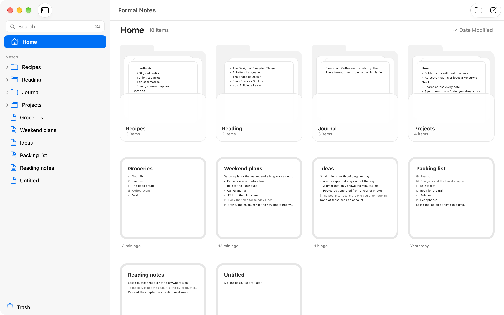
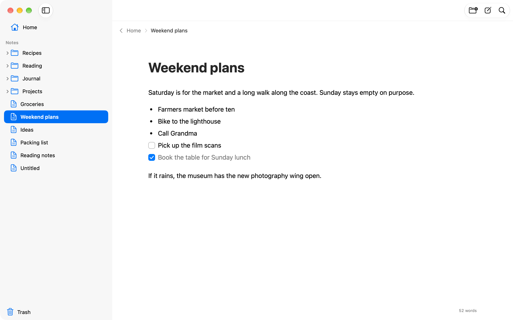

# Formal Notes

Notes that stay plain Markdown files. Your library is a folder (`~/Documents/Formal Notes`
unless you pick another), every note in it is a `.md` file, and folders are folders. Edit a
file in another app and Formal Notes picks the change up.

<picture>
  <source media="(prefers-color-scheme: dark)" srcset="docs/shots/home-dark.png">
  
</picture>

The desktop app is built on [NativeDesktop](https://github.com/FormalStudio/NativeDesktop):
AppKit controls on macOS, GPUI on Linux and Windows. There is an iPhone app in `mobile/` and
a sync server in `server/`.

## Writing

Open a note and it grows out of its card into the editor. You type Markdown and see it styled
in place, with the syntax dimmed instead of hidden. The first `# ` heading is the title. Edits
save on their own about half a second after you stop typing. Deleting moves things to a
`.trash` folder in the library, so you can put them back.

<picture>
  <source media="(prefers-color-scheme: dark)" srcset="docs/shots/editor-dark.png">
  
</picture>

## Tables and properties

A folder shows as cards or as a table; switch with the View control in the toolbar. In a
table each note is a row and each column is a property: text, number, checkbox, date, select,
multi-select or URL. Sort by a column, filter, and edit cells in place.

Properties live at the top of the note as YAML front matter, the way Obsidian writes them, so
they stay readable anywhere. The folder's columns and sort are kept in a `.folder.json` next
to the notes.

## Ask and automations

Bring your own model. In Settings, pick the provider format (Anthropic or OpenAI), paste your
key, and optionally set a model or a base URL for a gateway or a local server. The key goes in
the OS keychain. Requests go from your device straight to the provider.

Or use Claude Code. With the provider set to Claude Code, the desktop app runs the `claude`
command installed on that computer, on the account it is signed in to, and needs no key.
Claude Code gets the question and the app's note tools and nothing else: its own tools are
off, so it cannot read files or run commands.

Turn on Sharing in Settings and the desktop app also answers Ask for your phone. It shows an
address and an access code under Assistant; on the phone, choose Your Computer as the
provider and enter both. The phone still searches its own copy of the notes; the computer
only lends the model. The connection is plain HTTP, so keep it to your own network or a VPN.

- **Ask Your Notes** (`Shift+Cmd+A`) answers from your library and links the notes it used.
- **Organize brain dumps** is off until you turn it on. Write anything into the inbox folder
  (`Inbox` by default). After the note has rested for five minutes the model splits it into
  titled notes, files them into your folders and fills in the columns of any table they land
  in. The notice it leaves has an Undo.

## Sync

Sign up in Settings, under Account, and the library syncs through `notes.formalsnake.dev`.
Notes are encrypted on the device with a key derived from your password, so the server only
stores ciphertext. That also means a forgotten password cannot be reset. Signing out or
deleting the account leaves the local files alone.

The wire format, limits and error codes are in [docs/protocol.md](docs/protocol.md).

## Run it

```sh
just dev                          # the desktop app on your library
FORMALNOTES_DEMO=1 just dev       # a demo library in a temp folder
nd check                          # fmt, clippy, framework lints, appearance audit
nd test                           # tiers 1 and 2; add --tier real for real windows

cd mobile && bun install && bun run ios     # the iPhone app, in the simulator
cd server && bun install && bun run dev     # the sync server (Hono on a Cloudflare Worker)
```

## Keyboard

| | |
|---|---|
| `Cmd+N` / `Shift+Cmd+N` | new note / new folder in the current folder |
| `Cmd+K` | command palette |
| `Cmd+J`, `Cmd+F` | search notes (in the editor `Cmd+F` finds in the note, `Cmd+G` the next match) |
| `Shift+Cmd+A` | ask your notes |
| `Cmd+1` | Home |
| `Cmd+[` | back |
| `Cmd+Backspace` | move the open note to the trash |
| `Cmd+B`, `Cmd+I` | bold, italic |
| `Tab`, `Shift+Tab` | nest or lift a list item |
| `Cmd+\` | toggle the sidebar |
| `Cmd+,` | Settings |

`Ctrl` in place of `Cmd` on Linux and Windows.
